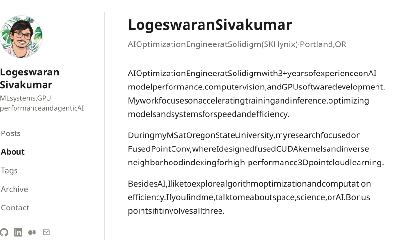
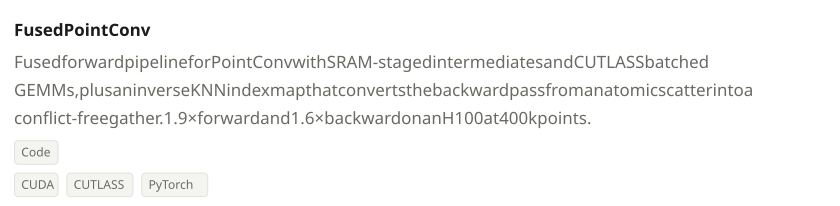

<!-- Generated by tools/build.py; edit tools/profile.toml instead. -->

<a href="https://logeswaranofficial.com"><picture><source media="(prefers-color-scheme: dark)" srcset="assets/header-dark.svg"></picture></a>

<a href="https://logeswaranofficial.com"><picture><source media="(prefers-color-scheme: dark)" srcset="assets/link-logeswaranofficial-com-dark.svg"></picture></a> <a href="https://www.linkedin.com/in/logeswaransivakumar"><picture><source media="(prefers-color-scheme: dark)" srcset="assets/link-linkedin-dark.svg"></picture></a> <a href="https://logessiva.medium.com"><picture><source media="(prefers-color-scheme: dark)" srcset="assets/link-medium-dark.svg"></picture></a> <a href="https://www.youtube.com/channel/UCRRxBDHkn8F3Sku98eoqzJw"><picture><source media="(prefers-color-scheme: dark)" srcset="assets/link-youtube-dark.svg"></picture></a>

<a href="https://logeswaranofficial.com/about/"><picture><source media="(prefers-color-scheme: dark)" srcset="assets/title-projects-dark.svg"></picture></a> 
<a href="https://github.com/Logeswaran123/tessiq"><picture><source media="(prefers-color-scheme: dark)" srcset="assets/project-tessiq-dark.svg"></picture></a> 
<a href="https://github.com/Logeswaran123/ml-pointconvformer-optim"><picture><source media="(prefers-color-scheme: dark)" srcset="assets/project-fused-pointconv-dark.svg"></picture></a> 
<a href="https://github.com/Logeswaran123/distilling-step-by-step-rag"><picture><source media="(prefers-color-scheme: dark)" srcset="assets/project-distilling-llms-with-rag-dark.svg"></picture></a> 
<a href="https://github.com/Logeswaran123/Multiscale-Template-Matching"><picture><source media="(prefers-color-scheme: dark)" srcset="assets/project-multiscale-template-matching-dark.svg"></picture></a> 
<a href="https://github.com/Logeswaran123/Stable-Diffusion-Playground"><picture><source media="(prefers-color-scheme: dark)" srcset="assets/project-stable-diffusion-playground-dark.svg"></picture></a>

<a href="https://logeswaranofficial.com/"><picture><source media="(prefers-color-scheme: dark)" srcset="assets/title-posts-dark.svg"></picture></a> 
<a href="https://logeswaranofficial.com/blog/building-a-pytorch-backend/"><picture><source media="(prefers-color-scheme: dark)" srcset="assets/post-building-a-pytorch-backend-dark.svg"></picture></a> 
<a href="https://logeswaranofficial.com/blog/3d-gaussian-splatting/"><picture><source media="(prefers-color-scheme: dark)" srcset="assets/post-3d-gaussian-splatting-dark.svg"></picture></a>
